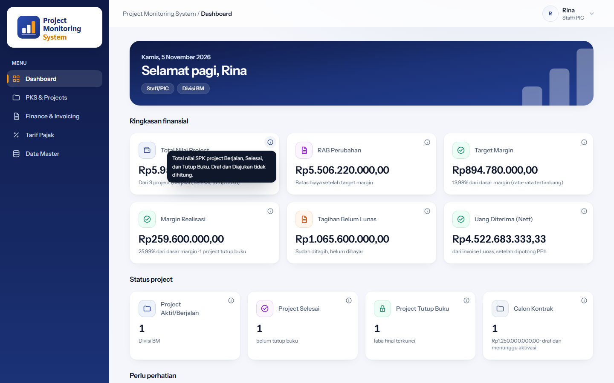
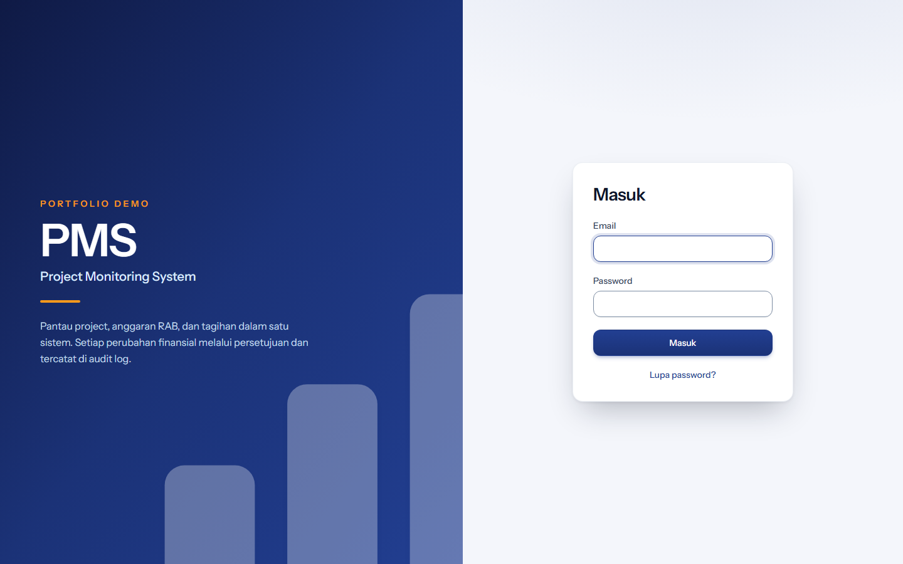
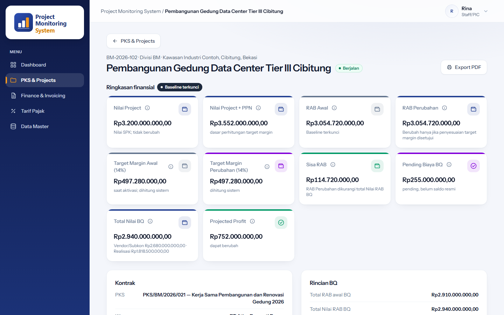
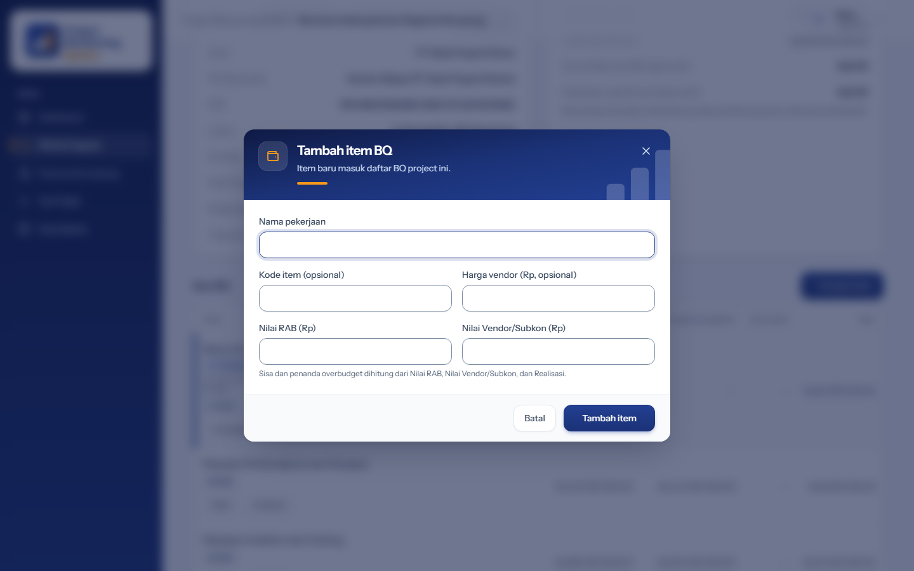
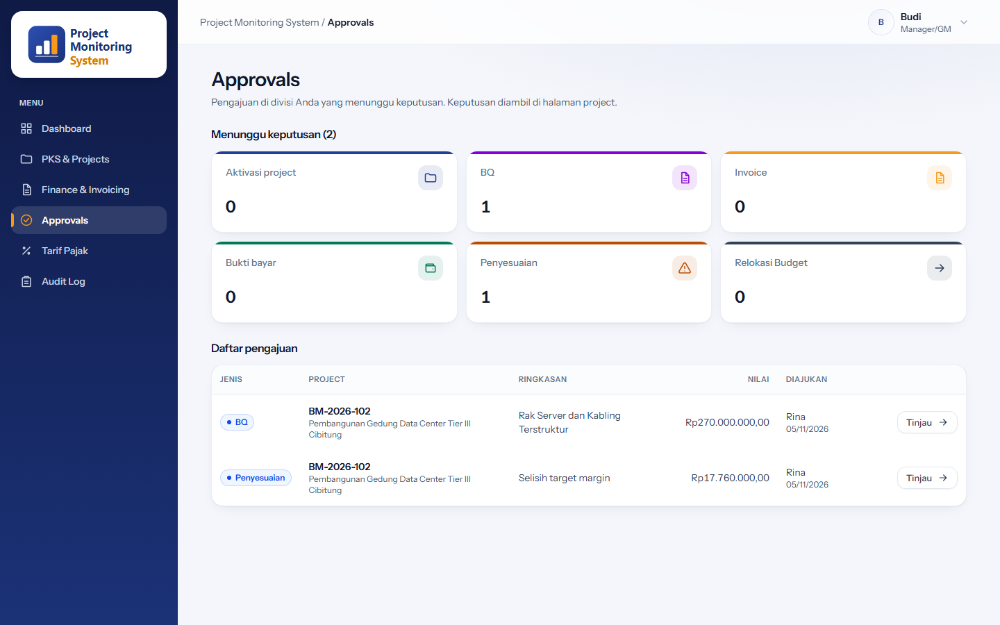
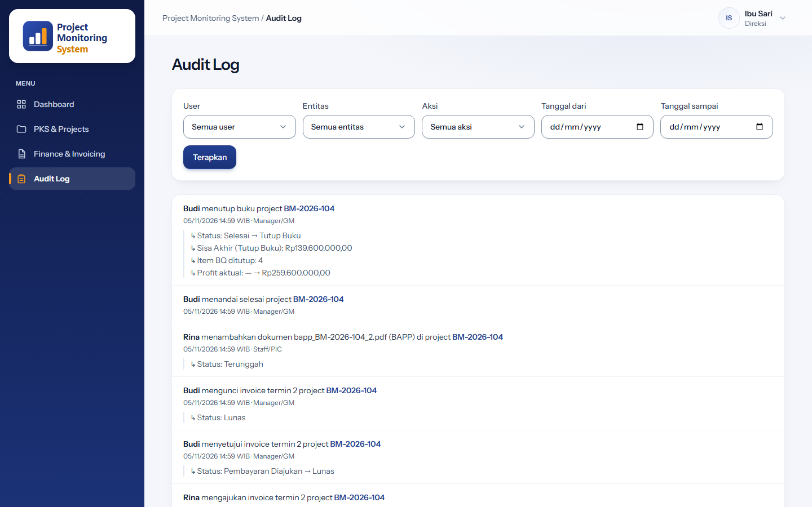
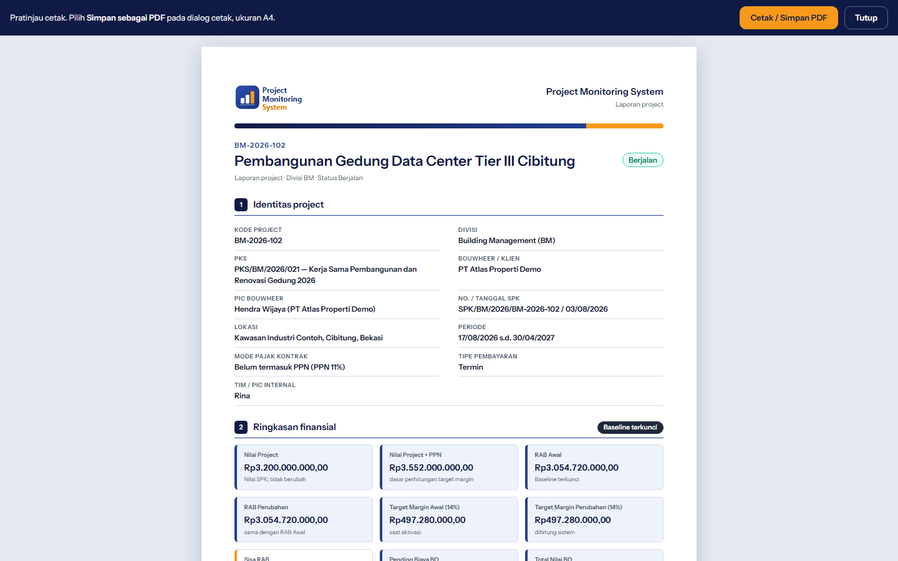
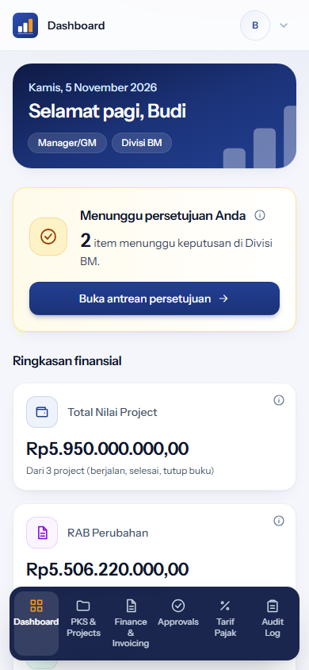
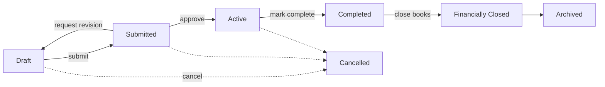

# Project Monitoring System

*Sistem monitoring project dan keuangan untuk divisi building management.*

A project and financial monitoring web app for a building-management division. It replaces spreadsheet tracking of projects, cost budgets (RAB), bills of quantities (BQ), billing terms and invoices, taxes, and financial closing with one audited, role-based system where every material financial change goes through an approval step.



## Screenshots

| | |
|---|---|
|  |  |
| **Login** | **Project detail**: financial summary with locked baseline, Sisa RAB, projected profit |
|  |  |
| **Popup CRUD form** (add a BQ item) | **Manager approval inbox**: BQ, adjustments, invoices, payment proofs, budget relocation |
|  |  |
| **Human-readable audit log** with user, entity, action, and date filters | **Per-project A4 PDF export** via browser print |
|  | |
| **Mobile-first** responsive dashboard | |

## Key features

- **Status workflows with approve / request-revision loops** for projects, BQ, budget mutations and adjustments, and a two-stage invoice flow (invoice file verified first, payment proof verified second). Transitions are declared per enum (`app/Enums`) and enforced by the backend.
- **Four-eyes rule**: the user who submits a transaction cannot approve it.
- **Exact decimal money**: all amounts go through BCMath (`App\Support\Money`), round half-up to 2 decimals, never binary floats. Term allocation distributes rounding so the terms always sum exactly to the contract.
- **Automatic tax calculation**: VAT (PPN) 11%, withholding tax (PPh) chosen by vendor qualification, rates versioned by effective date. The rate used is snapshotted on each invoice, and a missing rate is a validation error, never a silent 0.
- **Budget guard**: remaining unallocated budget (Sisa RAB) cannot go negative; the error message names the offending item and how to fix it.
- **Financial closing (Tutup Buku)** with system-checked preconditions; final profit is locked once closed.
- **Human-readable audit log**: every material change is recorded and rendered as a sentence with before/after values.
- **Role-based access**, enforced server-side: Staff/PIC and Manager/GM (scoped to their own division), Directors (read-only), System Admin.
- **Popup CRUD forms** and a **per-project A4 PDF export** (browser print, no PDF library).
- **Mobile-first responsive UI**; financial operations are online-only. (An installable PWA manifest and service worker are on the backlog, not yet implemented.)
- **No hard delete** of financial transactions, historical documents, or audit logs.

## Project lifecycle



The financial baseline is locked from Active onward. Later changes go through budget mutations or adjustments that need approval and never overwrite the baseline.

## Tech stack

Laravel 13, PHP 8.4, MySQL 8, Blade, Alpine.js, Tailwind CSS v4, Vite. A server-rendered monolith, with no separate SPA or API layer. 700+ feature and unit tests (PHPUnit, run against MySQL).

## Getting started

Requirements: PHP 8.3+ (developed on 8.4) with BCMath, Composer, Node.js and npm, MySQL 8.

```bash
git clone <this-repo-url> project-monitoring-system
cd project-monitoring-system
composer install
npm install
cp .env.example .env
php artisan key:generate
# create an empty MySQL database, then set DB_* in .env (the example uses project_monitoring)
php artisan migrate --seed
npm run build
php artisan serve
```

Demo accounts (seeded, password `password`; the seeder creates users and tax rates only, no sample projects):

| Email | Role |
|---|---|
| `admin@example.com` | System Admin |
| `staff.bm@example.com` | Staff/PIC |
| `manager.bm@example.com` | Manager/GM |
| `direksi@example.com` | Director (read-only) |

### Running tests

Create an empty MySQL database named `project_monitoring_test` (see `phpunit.xml`), then:

```bash
php artisan test
```

## My role

Product owner and lead developer. I defined the business rules, prioritized the backlog, reviewed every change, and ran UAT. The implementation was built with a team of AI coding agents (Claude Code) working under my direction, each story closed by independent QA.

## Language and glossary

The UI is in Indonesian. Domain terms:

| Term | Meaning |
|---|---|
| RAB | Cost budget (Rencana Anggaran Biaya) |
| BQ | Bill of quantities |
| PKS | Cooperation agreement (the framework contract above projects) |
| Bouwheer | Client / project owner |
| Termin | Billing term (a staged invoice of the contract value) |
| Tutup Buku | Financial closing |

## License

MIT, see [LICENSE](LICENSE).
